# Hodgkin–Huxley from scratch: numerics, validation and excitability

*Deborshi Chakravorty*

A tested Python package that simulates the Hodgkin–Huxley (HH) squid-axon model with ODE solvers written from scratch, checks those solvers against theory and against SciPy, and uses them to study spiking, thresholds, refractoriness, channel blockers, phase-plane geometry and temperature.

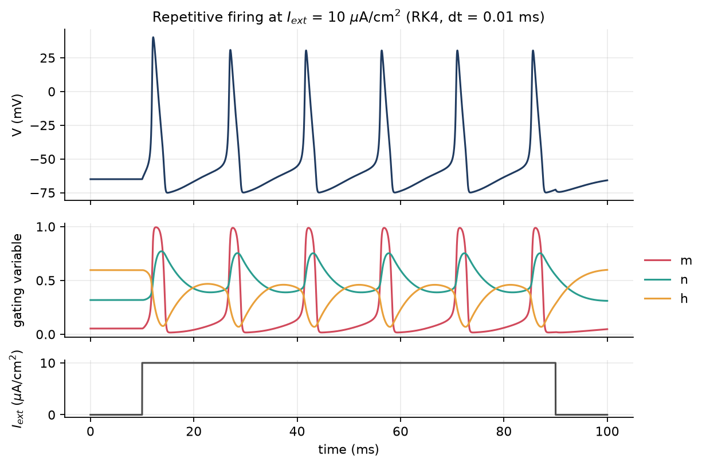

## Contents

1. [Headline results](#headline-results)
2. [Motivation](#motivation)
3. [The model](#the-model)
4. [Repository layout](#repository-layout)
5. [How to run](#how-to-run)
6. [Numerics](#numerics)
7. [Experiments](#experiments)
8. [Testing](#testing)
9. [Design decisions](#design-decisions)
10. [What I learned](#what-i-learned)
11. [Limitations](#limitations)
12. [References](#references)

---

## Headline results

| Topic | Result |
|---|---|
| Resting state | $V_{rest} = -64.996$ mV, $(m, n, h) = (0.0530, 0.3177, 0.5960)$; residual of the vector field there $< 10^{-14}$ |
| RK4 order | Measured order $3.89 \to 3.99$ through a full action potential |
| A hidden first-order bug | Stepping RK4 straight through a current *step* silently drops it to **order 1**; restarting at the jump restores order 4 |
| Own Dormand–Prince 5(4) | Uses **exactly** the same number of function evaluations as `scipy.integrate.solve_ivp(method="RK45")` at every tolerance tested, and agrees to round-off |
| RK4 stability | Blows up at $\Delta t \approx 0.095$ ms; linear stability theory along the orbit predicts $0.077$ ms (eigenvalue $\lambda \approx -36.4$ ms⁻¹ at the spike peak) |
| Stiffness | Mild. During spiking at tight tolerance, accuracy limits the step. In a 2 s quiet stretch, explicit solvers need ~16–19 k evaluations *whatever the tolerance*; implicit ones need 90–450 |
| Thresholds | 0.5 ms pulse: 13.2751 µA/cm²; rheobase (step): 2.240 µA/cm²; sustained firing from rest: 6.258 µA/cm² |
| All-or-none? | Not quite: the peak is a **graded, logarithmic** function of distance from threshold (FitzHugh's quasi-threshold), but the graded window is only ~10⁻¹⁰ µA/cm² wide |
| f–I | Type II: firing jumps from 0 to ~52 Hz. Bistable between 6.26 (fold of limit cycles) and 9.775 µA/cm² (subcritical Hopf); slow ramps show hysteresis |
| Refractoriness | Absolute ≈ 6.7 ms, relative until ≈ 15.8 ms, then a **supernormal** dip to 0.84× threshold at ~19 ms (rest is a stable focus) |
| TTX | Repetitive firing is lost first (none at ≤ 60 % $\bar g_{Na}$); single regenerative APs fail below ~14 % |
| TEA | Below ~55 % $\bar g_K$ rest destabilizes and the axon fires **spontaneously**; below ~11 % it sits in depolarization block |
| Phase plane | Rinzel's 2-D reduction with fitted $h \approx 0.870 - 1.073\,n$ reproduces the voltage-kick threshold (−60.07 vs −60.21 mV) but not the period (11.5 vs 14.6 ms) |
| Temperature | With $Q_{10}=3$, the Hopf interval closes at **28.86 °C**: above that no constant current produces repetitive firing |

## Motivation

The HH model (1952) is the founding example of mathematical neuroscience: four nonlinear ODEs, fitted to voltage-clamp data, that *predicted* the shape and speed of the action potential. It is also an excellent numerical-analysis testbed. It has fast and slow time scales, a vector field that is smooth but very steep during a spike, removable singularities in its rate functions, and dynamics (thresholds, bifurcations, bistability) that are extremely sensitive to numerical error. Building it from scratch makes you confront every one of these.

## The model

The state is $y = (V, m, n, h)$: membrane potential (mV) and three gating variables in $[0, 1]$.

$$
C\,\frac{dV}{dt} = I_{ext}(t) - \bar g_{Na}\, m^3 h\,(V - E_{Na}) - \bar g_K\, n^4\,(V - E_K) - \bar g_L\,(V - E_L)
$$

$$
\frac{dx}{dt} = \alpha_x(V)\,(1 - x) - \beta_x(V)\,x = \frac{x_\infty(V) - x}{\tau_x(V)}, \qquad x \in \{m, n, h\},
\qquad x_\infty = \frac{\alpha_x}{\alpha_x + \beta_x},\quad \tau_x = \frac{1}{\alpha_x + \beta_x}
$$

Rate functions (1/ms, $V$ in mV, modern convention with rest near −65 mV):

$$
\begin{aligned}
\alpha_n &= \frac{0.01\,(V+55)}{1 - e^{-(V+55)/10}}, & \beta_n &= 0.125\, e^{-(V+65)/80},\\
\alpha_m &= \frac{0.1\,(V+40)}{1 - e^{-(V+40)/10}}, & \beta_m &= 4\, e^{-(V+65)/18},\\
\alpha_h &= 0.07\, e^{-(V+65)/20}, & \beta_h &= \frac{1}{1 + e^{-(V+35)/10}}.
\end{aligned}
$$

| Parameter | Value | Parameter | Value |
|---|---|---|---|
| $C$ | 1 µF/cm² | $E_{Na}$ | 50 mV |
| $\bar g_{Na}$ | 120 mS/cm² | $E_K$ | −77 mV |
| $\bar g_K$ | 36 mS/cm² | $E_L$ | −54.387 mV |
| $\bar g_L$ | 0.3 mS/cm² | $T_{ref}$ | 6.3 °C |

**Units.** These are ms, mV, µA/cm², mS/cm² and µF/cm². They are self-consistent: (mS/cm²)·mV = µA/cm² and (µA/cm²)/(µF/cm²) = mV/ms, so no conversion factors appear anywhere.

**Removable singularities.** $\alpha_m$ and $\alpha_n$ are $0/0$ at $V=-40$ and $V=-55$ mV. With $u = -(V - V_0)/k$,

$$
\frac{a\,(V-V_0)}{1 - e^{-(V-V_0)/k}} = a k\,\frac{u}{e^u - 1} = \frac{a k}{\operatorname{exprel}(u)},\qquad \operatorname{exprel}(u) = \frac{e^u - 1}{u},\ \operatorname{exprel}(0) = 1,
$$

and `scipy.special.exprel` evaluates this accurately everywhere (a Taylor series near 0). The naive formula is not just undefined at $V_0$; it is also *inaccurate near* $V_0$, because numerator and denominator cancel. At $10^{-13}$ mV from $V_0$ it is already 0.44 % wrong. The analytic Jacobian needs $\frac{d}{du}\frac{u}{e^u-1}$, which has the same problem one derivative higher; it uses a Taylor branch for $|u| < 10^{-3}$.

**Initial condition.** At an equilibrium every gate sits at $x_\infty(V)$, so equilibria solve the scalar equation $I_{ss}(V) := \sum I_{ion}(V, x_\infty(V)) = I_{ext}$. $I_{ss}$ is strictly increasing (this is tested), so the equilibrium is unique for every current. Brent's method gives $V_{rest} = -64.996$ mV, and every experiment starts there with the gates at their steady states.

## Repository layout

```
hh/
  config.py        every parameter, protocol setting, tolerance, seed and plot style
  model.py         rate functions, vector field, analytic Jacobian, resting state, Rinzel reduction
  stimuli.py       current protocols (step, pulse pair, ramp), with breakpoints
  solvers.py       RK4, Butcher tableaux, generic fixed-step RK, adaptive Dormand-Prince, stability
  experiments.py   simulate(), spike detection, thresholds, f-I, refractoriness, equilibria
  plotting.py      shared style and plots
scripts/           one script per milestone/experiment; each saves figures/ and prints its numbers
  run_all.py       regenerates everything and logs each script's output to results/
tests/             pytest suite (98 tests, ~1 min)
figures/           generated figures
results/           generated numeric logs, one per script
```

## How to run

Requires Python ≥ 3.11 (developed on 3.14).

```bash
python3 -m venv .venv
source .venv/bin/activate
pip install -r requirements.txt
pip install -e .
```

```bash
pytest -q
```

```bash
python scripts/run_all.py
```

`run_all.py` takes about 15 minutes. Individual scripts take 10 s – 3 min each, e.g. `python scripts/exp3_refractory.py`. Every number quoted below is printed by the scripts and saved in `results/`.

---

## Numerics

### 1. Fixed-step RK4

$$
\begin{aligned}
k_1 &= f(t, y), & k_2 &= f(t + \tfrac{h}{2}, y + \tfrac{h}{2}k_1),\\
k_3 &= f(t + \tfrac{h}{2}, y + \tfrac{h}{2}k_2), & k_4 &= f(t + h, y + h k_3),\\
y_{n+1} &= y_n + \tfrac{h}{6}(k_1 + 2k_2 + 2k_3 + k_4).
\end{aligned}
$$

The weights make the update agree with the Taylor series of the true solution through $h^4$. That leaves a local error of $O(h^5)$ and, summed over $T/h$ steps, a global error of $O(h^4)$. When $f$ depends only on $t$, $k_2 = k_3$ and the step reduces to Simpson's rule, which is why RK4 integrates cubics exactly (a test checks this). The solver is vectorized: the state can be `(4,)` or `(4, N)`, and N independent trials (currents, intervals, even parameter values) advance in one pass.

### 2. A first-order bug hiding in a fourth-order method

The first convergence test with a current *step* measured order **1.00**, not 4. The step turns on at a grid point $t_{on}$. In the step that ends there, the last stage $k_4$ is evaluated at $t_{on}$, already sees the current, and adds a spurious $\tfrac{h}{6}\,I/C$ to $V$: an $O(h)$ error. More generally, RK order theory assumes $f$ is smooth across each step; a jump anywhere inside a step costs you the order.

The fix, used throughout, is `hh.experiments.simulate()`. It splits the time interval at the stimulus's *breakpoints* and restarts the solver on each smooth piece. For piecewise-constant stimuli it also freezes the current at its mid-piece value, so each piece is an autonomous ODE. A regression test checks both halves: naive order ≈ 1, piecewise order ≈ 4.

### 3. Adaptive Dormand–Prince 5(4), from scratch

Each step evaluates 7 stages and forms two solutions: a 5th-order one (kept, "local extrapolation") and an embedded 4th-order one. Their difference $\text{err} = h\sum_i (b_i - \hat b_i)k_i = O(h^5)$ estimates the local error.

* **Error norm.** $\|\text{err}\| = \sqrt{\tfrac{1}{n}\sum_i (\text{err}_i / sc_i)^2}$ with $sc_i = \text{atol} + \text{rtol}\cdot\max(|y_i|, |y_{new,i}|)$. Accept iff $\|\text{err}\| \le 1$.
* **Step control.** The estimate scales like $h^5$, so the step that would give $\|\text{err}\| = 1$ is $h\,\|\text{err}\|^{-1/5}$. The new step is $0.9\,h\,\|\text{err}\|^{-1/5}$, clipped to $[0.2h, 10h]$, and never grows straight after a rejection. An optional **PI controller** (Hairer's constants: $h \cdot 0.9\,\text{err}_n^{-0.17}\,\text{err}_{n-1}^{0.04}$) is also implemented.
* **FSAL.** The 7th stage is evaluated at $(t+h, y_{new})$, which is exactly the next step's first stage, so an accepted step costs 6 evaluations. A test checks $\text{nfev} = 2 + 6\,(\text{accepted} + \text{rejected})$.
* **Initial step.** Hairer–Nørsett–Wanner's heuristic: estimate $|y'|$ and $|y''|$ with one Euler probe and choose $h_0$ so that the leading error term is about $0.01$.
* **Dense output.** Shampine's 4th-order continuous extension. In exact rational arithmetic its endpoint value equals $y_{n+1}$ and its endpoint slope equals $k_7$, so the interpolant is $C^1$ across steps. Output times never constrain the step.
* **Robustness.** A trial step so large that $V$ becomes absurd can overflow `exp`. A non-finite error estimate is treated as "reject and shrink 5×".

**Validation.** The Butcher tableau satisfies all 17 order conditions up to order 5, and the embedded weights satisfy those up to order 4 but not 5. The stability polynomial is $R(z) = \sum_{k=0}^{5} z^k/k! + z^6/600$. Most strikingly, **my implementation and `solve_ivp(method="RK45")` take identical step sequences** (1232, 3086, 10604 evaluations at tolerances 10⁻³, 10⁻⁶, 10⁻⁹) and agree to ~10⁻⁹. They are two independent implementations of the same algorithm.

### 4. Convergence order

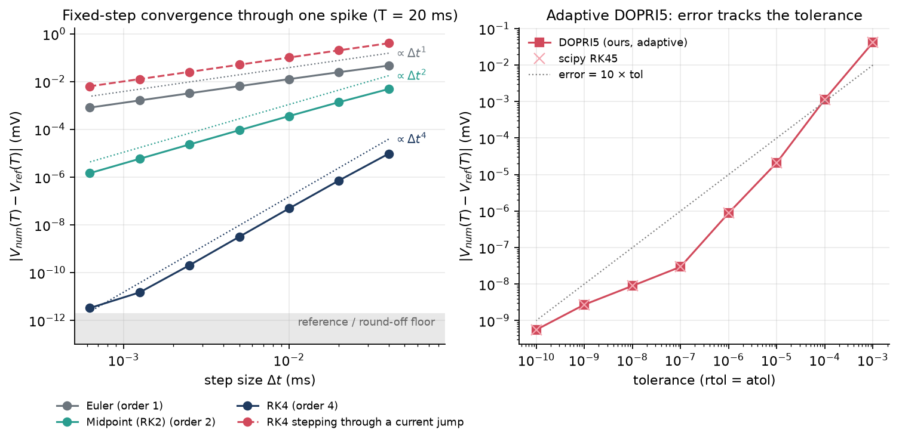

Errors are measured against a reference solution: DOP853 at rtol = atol = 10⁻¹², cross-checked against Radau, with agreement to 10⁻¹². Measured orders through one spike (smooth forcing, $T = 20$ ms):

| Method | Observed orders as $\Delta t$ halves |
|---|---|
| Euler | 0.92, 0.96, 0.98, 0.99, 0.99, 1.00 |
| Midpoint (RK2) | 1.84, 1.93, 1.97, 1.98, 1.99, 2.00 |
| RK4 | 3.73, 3.88, 3.94, 3.96, then the reference/round-off floor at ~10⁻¹² |
| RK4 through a current jump | 0.99, 1.00, 1.00, 1.00, 1.00, 1.00 |

The ratio $\log_2(e(h)/e(h/2))$ only approaches $p$ in the *asymptotic regime*, which is why the coarse-step orders sit below $p$. Right panel: DOPRI5's error falls with the tolerance and tracks scipy's RK45 point for point.

### 5. Work–precision

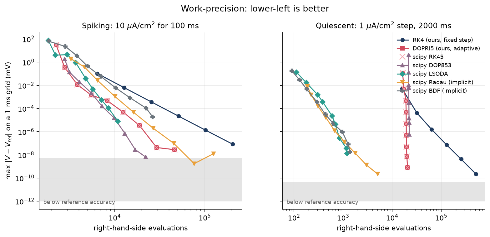

The error is the **maximum** $|V - V_{ref}|$ **over a 1 ms output grid**, i.e. over the whole trajectory. The cost is the number of right-hand-side evaluations, counted by my own wrapper. scipy's `nfev` leaves out the extra calls Radau/BDF make to build finite-difference Jacobians, which would flatter them.

* **Spiking (10 µA/cm², 100 ms).** DOP853 (8th order) and LSODA are cheapest at moderate accuracy, and DOP853 reaches the highest accuracy. DOPRI5/RK45 come next, then Radau and BDF, which pay for Newton iterations and Jacobians, and finally fixed-step RK4, whose step must be small enough for the spike *everywhere*, including the slow interspike stretch.
* **Quiescent (1 µA/cm² step, 2 s).** The explicit methods form **vertical lines**: their cost barely depends on the tolerance. That is the fingerprint of stiffness (next section). LSODA, BDF and Radau are 10–200× cheaper.

Two things in this figure needed debugging:

1. Final-time error is useless in the quiet run, because every stable method ends at the same equilibrium. That's why the metric is error over the whole trajectory.
2. DOP853's *dense output* is ~4×10⁻⁸ off between its long (~1.3 ms) quiet-phase steps, even though its step values are accurate to 10⁻¹². So the reference run caps its step at 0.25 ms, and is independently cross-checked against RK4 with $\Delta t = 2^{-10}$ ms (agreement 5×10⁻¹¹ quiet, 5×10⁻⁹ spiking). The grey band marks this reference uncertainty. During spiking it is genuinely larger: at $dV/dt \approx 400$ mV/ms, a $10^{-11}$ ms timing difference is already $4\times10^{-9}$ mV.

### 6. What happens as the step grows

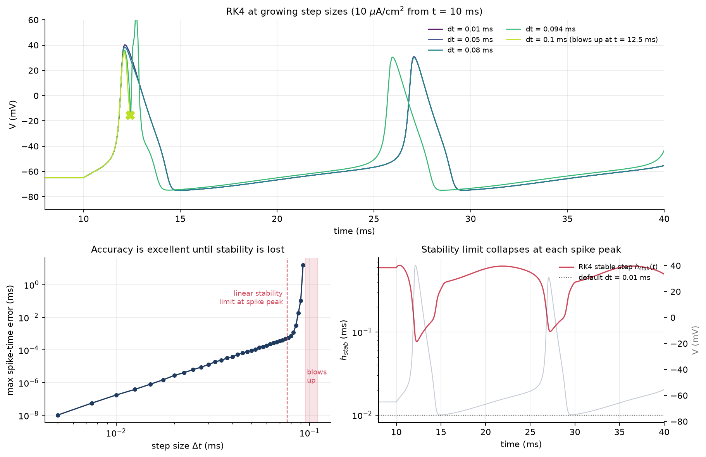

Spike-time errors fall smoothly as $\Delta t^4$ (they are measured with a cubic Hermite interpolant using the exact $dV/dt$, so the post-processing is $O(\Delta t^4)$ too), right up to $\Delta t \approx 0.09$ ms. Then RK4 **blows up** during the downstroke of the first spike (first failure in the scan at 0.095 ms).

Linear stability predicts this. Along the orbit, the Jacobian's most negative eigenvalue is $\lambda \approx -36.4$ ms⁻¹, at the spike peak. RK4 is stable for $h\lambda \in [-2.785, 0]$ on the real axis, so the limit is $h \lesssim 0.077$ ms (bottom right: the stable step $h_{stab}(t)$ collapses at every peak). RK4 survives slightly beyond this because the dangerous eigenvalue lasts only a fraction of a millisecond: a few amplifying steps are not yet a catastrophe.

**Missed spikes?** Not with RK4. The 0.5 ms pulse threshold computed with RK4 has relative error 10⁻⁹ at $\Delta t = 0.01$ and 2×10⁻⁶ at $0.0625$ ms (4th-order convergence), so only inputs within a hair of threshold could flip. For this model RK4 fails by instability long before it fails by missing spikes. Low-order methods (Euler) are different: their $O(\Delta t)$ errors visibly shift spike timing and threshold first.

### 7. Stiffness: does it matter here?

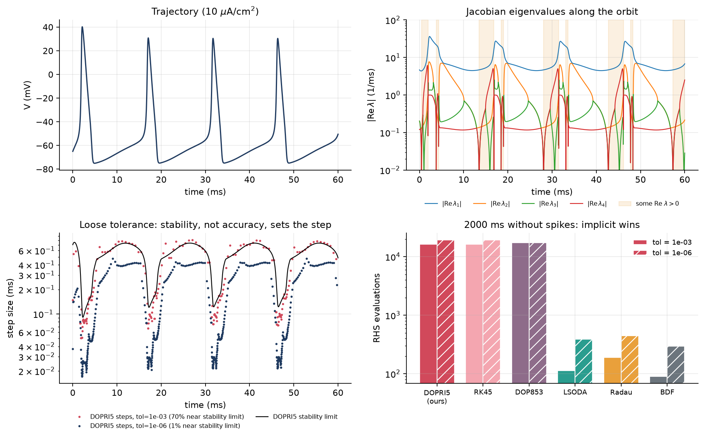

A problem is stiff when **stability, not accuracy, limits an explicit method's step**. Evidence:

* **Eigenvalues.** At rest they are $-4.68$, $-0.20 \pm 0.38i$ and $-0.12$ ms⁻¹, a stiffness ratio of 39. Along the orbit the fastest mode reaches $-36$ ms⁻¹ while others are near zero. For 28 % of the orbit one eigenvalue is *positive*: that is the regenerative Na upstroke, which is genuinely unstable and must be resolved, not damped.
* **Step sizes.** At tol 10⁻³, 70 % of DOPRI5's steps sit near its stability limit (bottom left), and the step sequence chatters around it. At tol 10⁻⁶ only 1 % do: accuracy is the binding constraint.
* **Long quiet stretches.** Over 2 s without spikes, the explicit methods need 16–19 k evaluations at *either* tolerance, while LSODA, BDF and Radau need 90–450 (bottom right).

**Verdict: HH is mildly stiff.** Explicit methods are the right choice for spiking at moderate-to-tight tolerances. During the spike the fast dynamics *are* the solution, so any method must resolve them, and the explicit methods are cheaper per step. An implicit (A- or L-stable) method wins when:

* the fast modes are **transients you don't care about**: long subthreshold periods, loose tolerances, steady states;
* the model has **much faster components than the spike**, e.g. multi-compartment cable models, where diffusion between compartments of size $\Delta x$ adds eigenvalues of order $-D/\Delta x^2$ that grow without bound as the mesh is refined;
* **fast kinetics** are added (Markov channel models, calcium buffering), or the temperature is high (all gating eigenvalues scale with $\phi$).

LSODA, which switches between Adams (non-stiff) and BDF (stiff) automatically, is the most robust single choice here: it is among the cheapest in both regimes, though it cannot reach DOP853's accuracy while spiking.

---

## Experiments

All experiment settings live in `hh/config.py` (`SPIKING`, `FI_CURVE`, `REFRACTORY`, `BLOCKERS`, `PHASE_PLANE`, `TEMPERATURE`). A **spike** is an upward crossing of 0 mV, and where that criterion could be fooled the experiments check it explicitly (see the passive ceiling below).

### Experiment 1 — current steps, thresholds, all-or-none

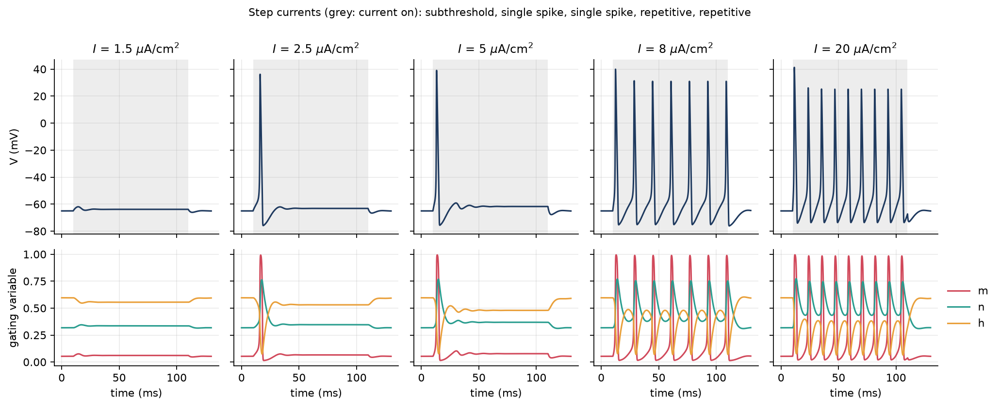

| Step amplitude (µA/cm²) | Response |
|---|---|
| 1.5 | subthreshold: damped ringing (rest is a focus) |
| 2.5, 5 | **one** spike, then a new depolarized steady state |
| 8, 20 | repetitive firing |

* **Rheobase** (smallest step giving any spike): **2.2403 µA/cm²**.
* **Sustained repetitive firing from rest** begins at **6.2579 µA/cm²**.
* **0.5 ms pulse threshold:** **13.2751235611 µA/cm²** (6.64 nC/cm²), found by vectorized multisection.

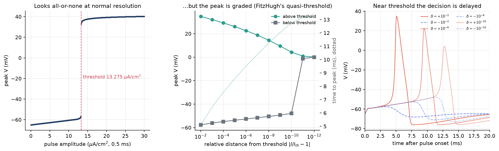

**Is the action potential all-or-none?** At normal resolution, yes (left). But zooming in on $\delta = I/I_{th} - 1$ (middle):

| δ | +10⁻² | +10⁻⁶ | +10⁻¹⁰ | −10⁻¹⁰ | −10⁻⁶ |
|---|---|---|---|---|---|
| peak V (mV) | 34.7 | 22.6 | 4.3 | −47.9 | −52.6 |

The peak is a *continuous*, roughly logarithmic function of δ, and the time to peak grows linearly in $\log|\delta|$ (≈ 0.98 ms per decade). This is FitzHugh's (1955) quasi-threshold. HH has no saddle point, hence no sharp threshold manifold. Instead, near-threshold trajectories shadow an unstable "middle" trajectory and leave it exponentially, $\propto e^{\lambda t}$ with $\lambda \approx \ln 10/0.98 \approx 2.4$ ms⁻¹, so the escape time is $\approx \ln(1/\delta)/\lambda$. Physiologically it is all-or-none, because the graded window is ~10⁻¹⁰ µA/cm² wide and channel noise swamps it. RK4 and DOPRI5 agree on these peaks to 0.1 mV even at δ = 10⁻¹¹, so this is the model, not the solver.

### Experiment 2 — f–I curve, bistability, onset of repetitive firing

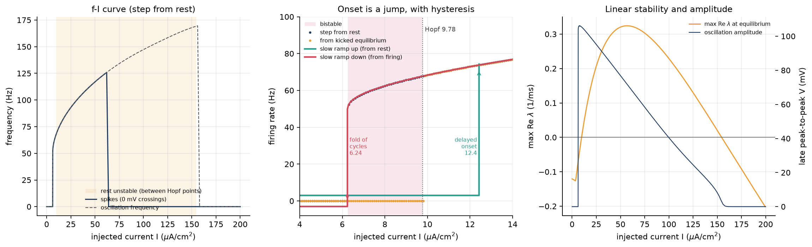

* **Type II onset.** The firing rate jumps from 0 to ~52 Hz instead of rising from 0. Rate at 10 µA/cm²: 68.3 Hz; at 50: 117 Hz.
* **Linear stability.** The equilibrium is unstable between two **Hopf bifurcations** at 9.7754 and 154.5224 µA/cm² (right panel: the max real part of the Jacobian's eigenvalues crosses 0).
* **Bistability.** Repetitive firing exists from **~6.26 µA/cm²**, below the Hopf point, so between 6.26 and 9.78 a stable rest state and a stable limit cycle coexist. The lower Hopf is *subcritical*, and the cycles are born at a fold (saddle-node of cycles). Three protocols reveal it (middle panel):
  * A **step from rest** kicks the state into the cycle's basin from 6.26 on.
  * Starting at the **equilibrium itself** (plus a tiny seeded 0.1 mV kick) stays silent until 9.9.
  * **Slow ramps** (0.002 µA/cm² per ms) trace a hysteresis loop. Going up, firing starts only at **12.4** (a *delayed* Hopf bifurcation: during the slow passage the perturbation is contracted by $\exp\int \mathrm{Re}\,\lambda\,dt$ and needs time to regrow). Coming down, firing persists to **6.24**, the fold.
* **Depolarization block.** Spike peaks fall below 0 mV above ~62 µA/cm², yet the membrane still oscillates, with amplitude shrinking continuously to 0 at the upper (supercritical) Hopf point at 154.5. The dashed curve counts these small oscillations with a midpoint-crossing detector.

**Debugging note.** The first version reported 0 Hz when starting *exactly* on the unstable equilibrium at 50 µA/cm². There, $f(y^*) \approx 10^{-14}$ and $h\,f$ is below half an ulp of $V$, so RK4 maps the equilibrium to itself **bit for bit**: on the computer, as in exact arithmetic, an unstable equilibrium is still a fixed point. Something must perturb you off it (in an axon, channel noise). That is what the seeded random kick is for.

### Experiment 3 — refractory periods

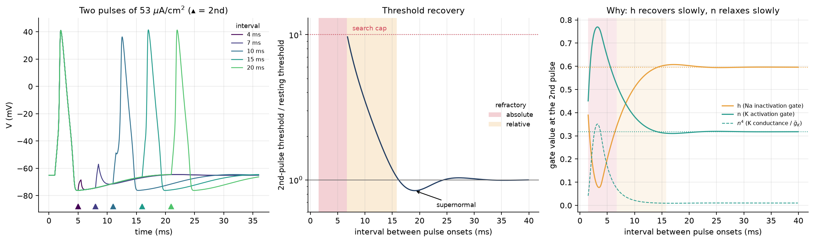

**Protocol.**
* A conditioning 0.5 ms pulse (2× threshold) fires a spike.
* After an interval, a second 0.5 ms pulse is applied, and its threshold is found by multisection, for 385 intervals simultaneously.
* The state at the second pulse is read from a single stored conditioning run, using the flow property $\varphi_{t+s} = \varphi_t \circ \varphi_s$. Only the 15 ms after each test pulse are simulated.

**Validity control.** The amplitude search is capped at 10× threshold (132.8 µA/cm²). The script injects that cap into a membrane **with no Na channels** from all 385 starting states: none reaches 0 mV. So every detected second spike is a genuine regenerative event.

| Interval | Threshold ratio | $h$ | $n$ | Phase |
|---|---|---|---|---|
| 5 ms | ∞ | 0.20 | 0.64 | **absolute** (ends at 6.7 ms) |
| 7 ms | 8.9 | 0.36 | 0.51 | relative |
| 10 ms | 3.5 | 0.51 | 0.38 | relative |
| 15 ms | 1.18 | 0.60 | 0.31 | relative (ends at 15.8 ms, 5 % criterion) |
| 19 ms | **0.84** | 0.61 | 0.31 | **supernormal** |
| 30 ms | 1.02 | 0.60 | 0.32 | recovered (small second wiggle) |

**Mechanism.**
* **Absolute phase.** Na channels are still inactivated ($h \approx 0.1$–$0.3$ vs 0.60 at rest), so there is too little Na conductance available to be regenerative. Meanwhile K channels are wide open ($n^4$ is up to 30× its resting value) and clamp $V$ toward $E_K$.
* **Relative phase.** It ends as $h$ recovers (τₕ ≈ 8.5 ms near rest) and $n$ relaxes (τₙ ≈ 5.5 ms). Late in this phase, $h$ and $n$ are back near rest, and the remaining elevation comes from the afterhyperpolarization itself (V ≈ −67 mV at 15 ms), which leaves V farther from threshold.
* **Supernormal phase.** Rest is a stable *focus* (eigenvalues $-0.20 \pm 0.38i$), so recovery overshoots: V rebounds slightly above rest, $h$ overshoots and $n$ undershoots. The damped period $2\pi/0.383 \approx 16$ ms matches the timing of the dip and the later small bump.

### Experiment 4 — channel blockers (TTX and TEA)

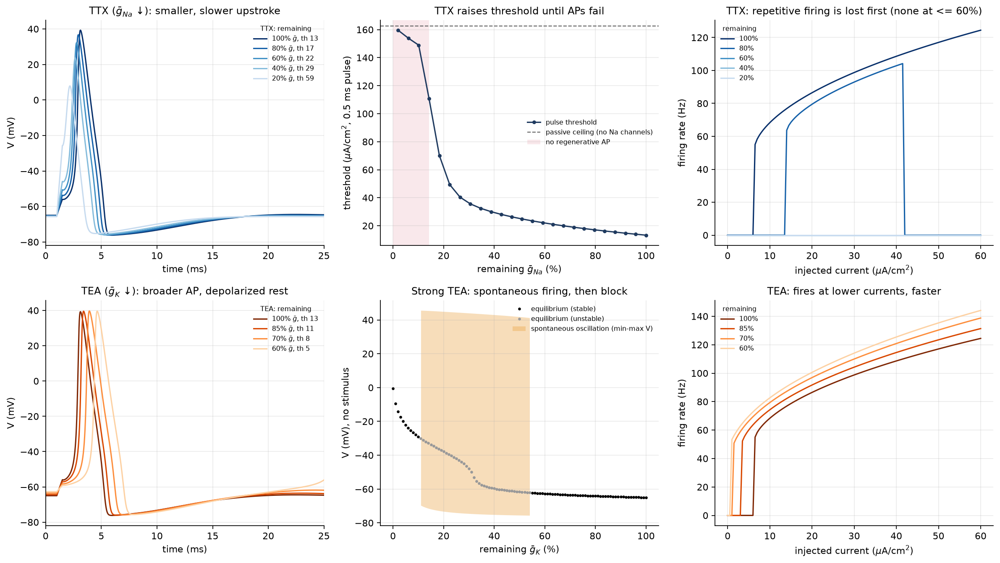

A blocker that removes a fraction of channels leaves the kinetics of the rest unchanged, so it maps exactly onto a smaller $\bar g$.

**TTX ($\bar g_{Na}$ ↓).**

| $\bar g_{Na}$ | threshold | peak | half-width | max dV/dt |
|---|---|---|---|---|
| 100 % | 13.3 µA/cm² | +39.3 mV | 1.46 ms | 299 mV/ms |
| 80 % | 17.0 | +36.7 | 1.38 | 263 |
| 60 % | 22.0 | +32.3 | 1.30 | 217 |
| 40 % | 29.4 | +23.7 | 1.24 | 158 |
| 20 % | 59.4 | +7.9 | 1.44 | 89 |

* The upstroke is driven by Na influx, so its speed (max dV/dt) and the peak fall roughly in proportion to $\bar g_{Na}$. The threshold rises because a larger depolarization is needed before the inward Na current can outrun the outward K and leak currents. Resting potential barely moves (−65.0 → −65.7 mV), since Na conductance at rest is tiny.
* **Repetitive firing is lost first.** The onset rises to 14 µA/cm² at 80 %, and at ≤ 60 % there is no repetitive firing at any current. Its equilibrium has no Hopf bifurcation left, because sustained firing needs enough Na channels to stay available under steady depolarization.
* **Single APs fail at ~14 % $\bar g_{Na}$.** That's where the threshold reaches 90 % of the **passive ceiling**: the pulse amplitude at which a membrane *with no Na channels at all* would reach 0 mV by charge alone (162.7 µA/cm²). Above it, a "0 mV crossing" no longer proves an action potential. My first, naive analysis reported TTX block only below 0.001 % $\bar g_{Na}$, which was this artefact.

**TEA ($\bar g_K$ ↓).**

| $\bar g_K$ | rest | threshold | half-width |
|---|---|---|---|
| 100 % | −65.0 mV | 13.3 µA/cm² | 1.46 ms |
| 85 % | −64.4 | 10.7 | 1.50 |
| 70 % | −63.5 | 7.7 | 1.55 |
| 60 % | −62.7 | 5.2 | 1.60 |

* Less K current means slower repolarization (broader APs), a depolarized rest (K contributes to the resting potential), and *more* excitability: a lower threshold, and a lower current for repetitive firing (6.5 → 1.0 µA/cm²) at higher rates.
* **Qualitative regimes (bifurcation panel).** Below **~55 %** $\bar g_K$, rest loses stability through a Hopf bifurcation and the axon fires **spontaneously** with no stimulus. Below **~11 %** a new stable state at about −29 mV appears: **depolarization block**. With no K channels, the membrane sits near −0.6 mV. These diagrams are computed by simulating 101 axons with different $\bar g_K$ in one batched run: parameters may be NumPy arrays that broadcast over trials.

### Experiment 5 — phase plane in the (V, n) plane

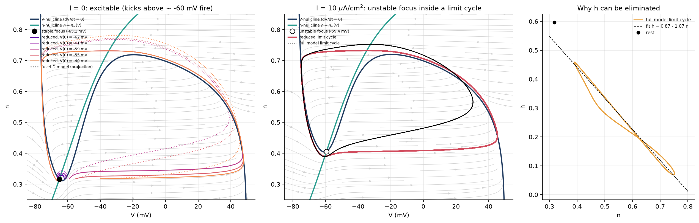

**Reduction (Rinzel 1985).**
1. $m$ is fast ($\tau_m \approx 0.1$–$0.5$ ms vs 1–8 ms for $n, h$), so set $m = m_\infty(V)$: the trajectory is assumed to have collapsed onto the slow manifold.
2. Along trajectories, $h$ and $n$ stay close to a line (right panel). A least-squares fit on the full limit cycle gives $h \approx 0.870 - 1.073\,n$ (RMS residual 0.013; Rinzel's published values are 0.89 − 1.1n).

The result is a planar system, so the Poincaré–Bendixson theorem applies and the whole phase portrait can be drawn:
* the **V-nullcline** $\dot V = 0$, which is N-shaped (cubic-like);
* the **n-nullcline** $n = n_\infty(V)$;
* their intersection, the equilibrium.

**I = 0: excitable.**
* The equilibrium is a **stable focus**: −65.1 mV, eigenvalues $-0.24 \pm 0.39i$.
* Kicks to −62 and −61 mV spiral back into it.
* Kicks to −59, −55 and −40 mV make the large excursion: right along the fast flow to the right branch of the V-nullcline, up as $n$ grows, back left to the left branch, then slowly down to rest. This is the slow–fast structure of a relaxation oscillator.
* The voltage-kick threshold is −60.07 mV in the reduced model and −60.21 mV in the full one.
* The full 4-D projections (dotted) bulge above the reduced orbits: the full trajectory starts with $h$ at its resting value, which is off the fitted line.

**I = 10 µA/cm²: oscillation.**
* The nullclines move, and their intersection becomes an **unstable focus** ($+0.17 \pm 0.66i$).
* Poincaré–Bendixson guarantees a limit cycle around it.
* The reduced cycle has the right shape, but its period is 11.5 ms vs 14.6 ms for the full model. The reduction changes the timing because it removes $h$'s own lag.

### Experiment 6 (extension) — temperature and $Q_{10}$

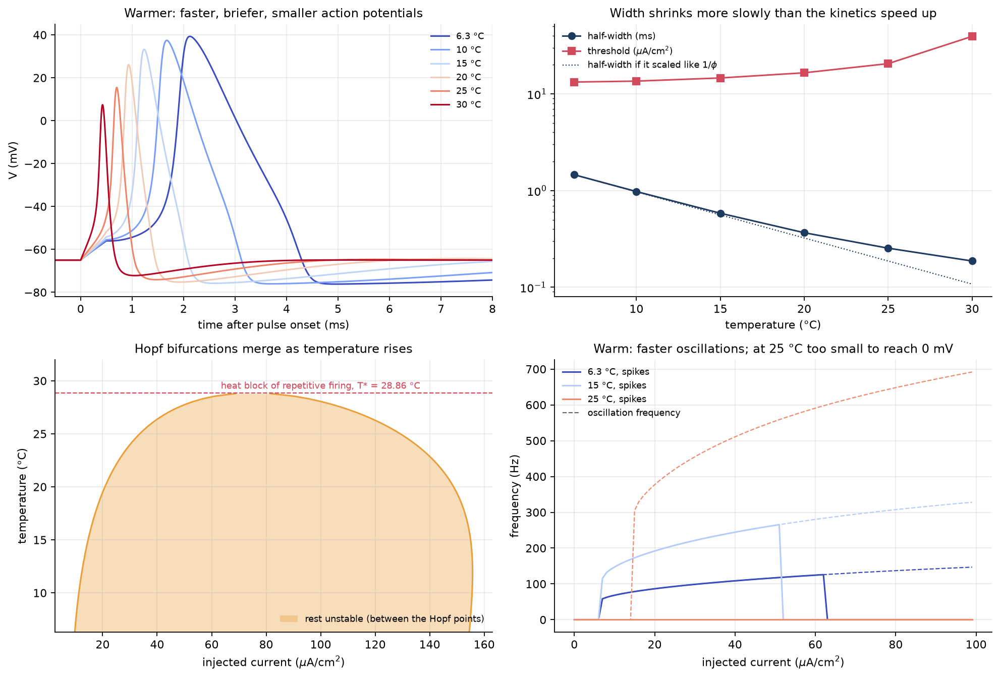

All rate constants are multiplied by $\phi = Q_{10}^{(T - 6.3)/10}$ with $Q_{10} = 3$. Steady states $x_\infty$ are unchanged, because $\phi$ cancels in $\alpha/(\alpha+\beta)$. Every gating time constant shrinks by $\phi$. The membrane time constant $C/g$ does **not** scale.

| T (°C) | φ | threshold (µA/cm²) | peak (mV) | half-width (ms) |
|---|---|---|---|---|
| 6.3 | 1.0 | 13.3 | 39.3 | 1.46 |
| 15 | 2.6 | 14.6 | 33.3 | 0.58 |
| 20 | 4.5 | 16.5 | 26.1 | 0.37 |
| 25 | 7.8 | 20.6 | 15.5 | 0.25 |
| 30 | 13.5 | 39.4 | 7.4 | 0.19 |

* **APs get faster, briefer and smaller.** The half-width tracks $1/\phi$ at first, then shrinks more slowly. The Na and K gates now open on similar time scales to each other and to the membrane's own charging time. K activation catches up with Na activation before the upstroke completes, which truncates the peak and raises the threshold.
* **Heat block of repetitive firing.** The two Hopf points move together as T rises and **merge at T\* = 28.86 °C** (bottom left; found by root-finding $\max_I \max \mathrm{Re}\,\lambda(T, I) = 0$). Above T\*, no constant current destabilizes rest.
* At 25 °C the membrane still oscillates (up to ~690 Hz), but with too small an amplitude to reach 0 mV.
* Fixed-step RK4 needs $\Delta t \propto 1/\phi$ here, because the stability limit scales with the fastest rate. That's why the temperature thresholds use the adaptive DOPRI5, which finds the step automatically, and the f–I runs use $\Delta t = 0.01/\phi$.

---

## Testing

`pytest -q` runs 98 tests in about a minute.

| File | Covers |
|---|---|
| `test_model.py` | **Rate functions:** the exprel form at the removable singularities (value equals the l'Hôpital limit; matches the textbook formula to 10⁻¹¹; correct slope through $V_0$; accurate where the naive form cancels). $x_\infty \in (0,1)$, $\tau > 0$, monotonicity; temperature scaling. **Rest:** matches textbook values, is a fixed point (residual < 10⁻¹²), currents balance. **Vector field:** forward invariance of $[0,1]^3$ for the gates; each current pushes $V$ toward its reversal potential. **Batching:** column-wise, mismatched-shape errors, parameter-array batching. |
| `test_solvers.py` | RK4 exact for cubic quadrature; order 4 on $y' = -2y$, on the passive membrane (analytic solution) and through an HH spike; the current-step order-1 regression; spike times vs scipy; charge conservation $C\,\Delta V = \int (I_{ext} - I_{ion})\,dt$; gates stay in $[0,1]$ under strong drive; batch = individual runs; evaluation counts; input validation. |
| `test_adaptive.py` | Order conditions up to order 5 for every tableau; the embedded pair is exactly order 4; dense-output endpoint conditions; stability polynomials equal $e^z$'s Taylor series to the method's order; real-axis stability limits (2, 2, 2.785, 3.307); RK4 blows up just beyond its limit; generic RK = hand-written RK4; Euler/midpoint orders; DOPRI5 exact for quartic quadrature, **step-for-step equal to scipy RK45**, tolerance-controlled, accurate dense output (I and PI controllers), correct nfev accounting, batch agreement; all 7 methods give the same spike times; analytic Jacobian vs finite differences; rest is a stable focus; multisection threshold search. |
| `test_experiments.py` | $I_{ss}$ monotone (unique equilibrium); Hopf points 9.7754/154.5224; firing-rate and oscillation-frequency detectors; f–I values; pulse threshold, passive ceiling, rheobase; AP metrics; refractory-curve shape; the $h$–$n$ fit; the reduced model; temperature speeds up spikes. |
| `test_stimuli_and_analysis.py` | Stimulus protocols and breakpoints; ramp current; spike detection, including the 4th-order Hermite crossing times. |

Writing the tests caught real bugs: the current-step order loss, a silent `(4, 4)` broadcasting coincidence, and a shape mismatch in the threshold search. It also caught several bugs *in the tests*. For example, Euler's error coefficient changes sign near $t = 2$, which makes its "measured order" there meaningless, and a sine crosses zero at an inflection point, which hides the leading interpolation error.

## Design decisions

Every non-obvious choice, with the reason for it.

**Project and environment**
* **Project-local `.venv`, pinned `requirements.txt`, editable install via `pyproject.toml`.** Reproducible, and scripts can `import hh` from anywhere. (The system Python lacked matplotlib.)
* **Scripts rather than notebooks.** Diffable, testable and rerunnable in one command. `run_all.py` saves each script's printed numbers to `results/`, so every number here is traceable.
* **One commit per milestone, MIT license, CI** (GitHub Actions runs `pytest` on every push).
* **One config module** (`hh/config.py`) holds the model parameters, every experiment protocol, solver tolerances, the random seed and the plot style.
* **Frozen dataclasses for parameters.** Variants like a TTX-treated axon are made with `dataclasses.replace`, never by mutation.

**Model**
* **Units ms/mV/µA/cm²/mS/cm²/µF/cm²**, because they need no conversion factors. Outward current is positive (the electrophysiology convention).
* **`exprel` for $\alpha_m, \alpha_n$**, not `if |V - V0| < eps` branches: exact at $V_0$, accurate near it, no tunable epsilon. The Jacobian's derivative of $u/(e^u-1)$ uses a Taylor branch for $|u| < 10^{-3}$ (truncation < 10⁻¹⁷; the closed form's cancellation error there is < 10⁻¹⁰).
* **Resting state** from Brent's method on the scalar equation $I_{ss}(V) = I$. Equilibria in general use a wide bracket (−120, 60) mV, justified by the tested monotonicity of $I_{ss}$.
* **Analytic Jacobian** for the stiffness and bifurcation analysis, tested against finite differences.
* **Temperature** scales only the rate constants ($\phi$), not the conductances, following HH's own convention; $T_{ref} = 6.3$ °C, $Q_{10} = 3$.

**Vectorization**
* **`rhs` accepts `(4,)` or `(4, N)`.** A batch of N currents, intervals or even parameter values (array-valued $\bar g$) runs in one integration. Batching amortizes NumPy's per-call overhead, which dominates small arrays.
* **`rhs` raises on mismatched batch shapes.** A `(4,)` state with N = 4 currents once broadcast silently to garbage.
* **Batch results equal single runs to ~10⁻¹², not bitwise.** NumPy may use SIMD `exp` for long arrays and the platform libm for short ones. Linux CI exposed a 1.6×10⁻¹² relative difference that macOS hid, so batch-equivalence tests use a 10⁻¹⁰ tolerance.

**Solvers**
* **RK4 written out by hand** (readable, fast) plus a generic tableau solver for Euler/midpoint. RK4 requires $\Delta t$ to divide the interval exactly, and recomputes $t = t_0 + i\,\Delta t$ instead of accumulating round-off.
* **DOPRI5 defaults mirror scipy's RK45** (I-controller, safety 0.9, factor in [0.2, 10], no growth after rejection, RMS scaled norm, Hairer's initial step). This made a *step-for-step* comparison possible, which is a far stronger test than "similar answers". PI control is optional.
* **Coefficients verified in exact rational arithmetic** (`fractions.Fraction`) before use.
* **Stability polynomials** via the terminating Neumann series $R(z) = 1 + \sum_k z^k\, b^\top A^{k-1}\mathbf 1$ (explicit $A$ is nilpotent), not a linear solve per $z$. Exact, fast, and immune to the overflow that made `np.linalg.solve` fail.
* **Non-finite error estimate ⇒ reject and shrink** (with overflow warnings silenced only inside trial stages).

**Integration across stimulus jumps**
* **`simulate()` splits time at stimulus breakpoints.** Piecewise-constant stimuli are frozen per piece. Ramps declare `piecewise_constant = False` and are evaluated as-is, but still split at their kinks. Each RK4 piece uses the largest step ≤ $\Delta t$ that divides it.

**Validation methodology**
* **Reference solutions** are DOP853 at 10⁻¹² tolerance, cross-checked against Radau or RK4 at $\Delta t = 2^{-10}$ ms. The reference run caps its step at 0.25 ms when dense output is used.
* **Cost = RHS evaluations, counted by my own wrapper**, which includes the finite-difference Jacobian calls of implicit methods that scipy's `nfev` omits. No analytic Jacobian is passed to scipy, so implicit methods pay their true cost.
* **Work–precision uses trajectory error** on a 1 ms grid, not final-time error, which is degenerate when all methods converge to the same equilibrium. RK4 steps are powers of two so they land on that grid exactly.
* **Convergence orders** are measured with smooth forcing and inside the asymptotic regime.
* **Spike times:** linear interpolation for counting; cubic Hermite with exact $dV/dt$ plus Newton for timing-error studies, so the measurement is as accurate as the solver.

**Experiments**
* **Spike = upward 0 mV crossing.** Simple and standard, but only meaningful when passive charging alone can't reach 0 mV. Hence:
  * the **passive ceiling** (threshold of a Na-free membrane);
  * the **refractory control run**;
  * "AP block" defined as threshold ≥ 90 % of the ceiling.
* **Threshold search by vectorized multisection**: 15 points per iteration in one batch, a 16× bracket reduction per iteration. Roughly 4× fewer simulations than bisection at essentially the same cost per iteration. It assumes a monotone response and validates result shapes.
* **0.5 ms pulses for thresholds:** brief compared with τₙ and τₕ, so they act like a charge kick. The step **rheobase** is measured separately.
* **Firing rate** = $1000\,(n-1)/(t_{last} - t_{first})$ after a 200 ms transient (the reciprocal mean ISI); fewer than 2 spikes counts as 0 Hz. **Oscillation frequency** counts crossings of each trace's own midpoint, ignoring traces under 1 mV peak-to-peak, so sub-0 mV limit cycles near block are still seen.
* **"From equilibrium" runs get a 0.1 mV seeded random kick**, because RK4 maps an equilibrium to itself bit for bit. **Slow ramps (0.002 µA/cm²/ms)** expose hysteresis without guessing a phase on the cycle. My first "start from a state on another current's limit cycle" protocol failed for exactly that reason.
* **Refractory protocol.**
  * Conditioning pulse 2× threshold; intervals measured onset-to-onset on a 0.1 ms grid.
  * Intervals before the conditioning spike's own 0 mV crossing are dropped, since they'd count the first spike twice.
  * Search capped at 10× threshold, validated by the Na-free control.
  * Relative period ends at ≤ 1.05× threshold.
  * The flow property lets one conditioning run seed every trial.
* **Blockers.**
  * $\bar g$ scaling.
  * AP shapes evoked by 1.5× each condition's *own* threshold, from its *own* equilibrium.
  * TEA shapes and f–I only for fractions where rest is stable (≥ 60 %); lower fractions appear in the bifurcation diagram instead.
* **Phase plane.**
  * $m = m_\infty(V)$.
  * The $h$–$n$ line is *fitted* on the full limit cycle at 10 µA/cm², not copied.
  * Kicks set V with $m = m_\infty(V_0)$ and $n, h$ at rest.
* **Temperature.**
  * Thresholds with adaptive DOPRI5; f–I with RK4 at $\Delta t = 0.01/\phi$.
  * Heat block defined as the merger of the Hopf points. A space-clamped membrane still fires single (small) APs above T\*, by the passive-ceiling test.

**Plotting**
* Agg backend (scripts only save files), one rc style from config, and one fixed colour per state variable (V, m, n, h) across all figures. Every axis is labelled with units.

## What I learned

I went into this thinking the hard part would be getting the equations right. It wasn't. The equations took an afternoon; working out whether I could *trust* what the computer told me about them took everything else.

The first surprise came early. I had RK4 working, the spikes looked perfect, and I wrote a convergence test mostly as a formality. It came back first order. It took me a while to believe it, because nothing looked wrong. The problem was that I was switching the current on mid-step, and RK4's fourth-order guarantee quietly assumes the right-hand side is smooth. I'd learned "RK4 is fourth order" as a fact. Now I think of it as a theorem with hypotheses, and I check the hypotheses.

Writing the Dormand–Prince solver taught me what convincing evidence looks like. "My answer is close to scipy's" felt reassuring but didn't prove much. When my implementation turned out to take *exactly* the same steps as scipy's RK45 at every tolerance, down to the last function evaluation, that was the moment I actually believed both of them.

I also finally understood stiffness, which had always been a slightly vague word to me. I had assumed a model either is or isn't stiff. Here it depends on what the neuron is doing: while it's spiking, the fast dynamics *are* the answer and explicit methods do fine; while it's resting, those same fast modes are just decaying noise, and an explicit solver wastes thousands of tiny steps on them. Watching the step sizes pile up against the stability limit made the definition click.

Some of my favourite moments were bugs that turned out to be lessons. My solver refused to leave an unstable equilibrium, and I spent a while hunting for a mistake before realising there wasn't one: the rounding error was smaller than half a unit in the last place, so the computer's version of the equilibrium was exactly stable. And my first TTX result said the axon kept firing with 0.001 % of its sodium channels, which is obviously absurd. The "spikes" were just a big current pulse charging the membrane past 0 mV. That one taught me that every detection rule needs a control experiment, not just a threshold that seems reasonable.

The biology turned out to be dynamical systems in disguise, which is the part I'll remember longest from my ODE course. The all-or-none spike isn't quite all-or-none: zoom in far enough and the response is graded on a log scale. The jump to repetitive firing is a subcritical Hopf bifurcation, with a range of currents where resting and firing coexist. The extra-excitable window after a spike is just the damped oscillation of a stable focus. And the temperature at which the model stops firing repetitively is where two Hopf points collide. Each of these is something I could predict from eigenvalues before I saw it in a simulation, and that felt like the point of the whole project.

## Limitations

**Of the model**
* **Space clamp.** There is no cable or propagation, so conduction velocity and propagation failure (where real heat and TTX block show up) are out of reach. A multi-compartment model would also be genuinely stiff.
* **Squid giant axon at 6.3 °C.** Mammalian neurons have many more channel types (persistent and resurgent Na, A-type, M-type and Ca-activated K, Ca channels) and different kinetics.
* **Deterministic, mean-field gating.** No channel noise, which matters near threshold (exactly where the model's graded response lives) and in small membranes.
* **Independent gates.** $m^3 h$ and $n^4$ are independent-gate approximations. Real Na inactivation is coupled to activation (Markov models are more accurate).
* **Lumped leak.** The leak bundles Cl⁻ and unspecified currents with $E_L = -54.4$ mV. Removing all K conductance therefore depolarizes the model to about 0 mV, which real axons with K leak channels would not do.
* **Fixed reversal potentials.** No ion accumulation or pumps, so long high-rate firing has no cost.
* **Temperature.** Only the rates scale; conductances also have $Q_{10} \approx 1.3$–1.5 in reality.

**Of this study**
* The spike criterion (0 mV) and the refractory/block criteria (5 %, 90 % of ceiling, 10× cap) are definitions. They are reported explicitly, but other choices shift the numbers.
* Bistability boundaries are located by simulation and Hopf points by linear stability. No numerical continuation (e.g. AUTO/MatCont) was used to trace the unstable limit cycle.
* The Rinzel reduction is qualitative: right geometry, about 20 % wrong period.

## References

* A. L. Hodgkin and A. F. Huxley (1952). A quantitative description of membrane current and its application to conduction and excitation in nerve. *J. Physiol.* 117, 500–544.
* R. FitzHugh (1955). Mathematical models of threshold phenomena in the nerve membrane. *Bull. Math. Biophys.* 17, 257–278.
* J. Rinzel (1985). Excitation dynamics: insights from simplified membrane models. *Fed. Proc.* 44, 2944–2946.
* J. Rinzel and R. N. Miller (1980). Numerical calculation of stable and unstable periodic solutions to the Hodgkin–Huxley equations. *Math. Biosci.* 49, 27–59.
* J. R. Dormand and P. J. Prince (1980). A family of embedded Runge–Kutta formulae. *J. Comput. Appl. Math.* 6, 19–26.
* L. F. Shampine (1986). Some practical Runge–Kutta formulas. *Math. Comp.* 46, 135–150.
* E. Hairer, S. P. Nørsett and G. Wanner (1993). *Solving Ordinary Differential Equations I*, 2nd ed. Springer.
* E. Hairer and G. Wanner (1996). *Solving Ordinary Differential Equations II: Stiff and Differential-Algebraic Problems*. Springer.
* G. B. Ermentrout and D. H. Terman (2010). *Mathematical Foundations of Neuroscience*. Springer.
* E. M. Izhikevich (2007). *Dynamical Systems in Neuroscience*. MIT Press.

## License

MIT — see [LICENSE](LICENSE).
